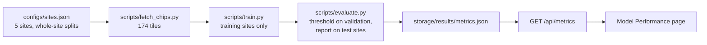

# Sylvan Watch

**Satellite-based forest-loss monitoring with transparent, site-held-out validation.**
Neural Storm 2026 · Problem statement **GP-04: Illegal Deforestation Detection** (Green Planet track)

Sylvan Watch compares cloud-masked Sentinel-2 composites from two periods, flags candidate forest loss with trained models,
and turns the result into georeferenced polygons with estimated area. Three detectors are implemented and compared against
Hansen forest-loss reference labels on geographically held-out sites.

Author: Shaik Saniya · Team: `<team name>` · Members: `<add members if required by the submission form>`

## Live demo and source

| Resource | Link |
|---|---|
| Application | https://project-mzb0n.vercel.app/ |
| Detection Workspace | https://project-mzb0n.vercel.app/workspace |
| Model Performance | https://project-mzb0n.vercel.app/performance |
| Reports | https://project-mzb0n.vercel.app/reports |
| Methodology | https://project-mzb0n.vercel.app/about |
| Backend API | https://sylvan-watch-api.onrender.com |
| API documentation (OpenAPI) | https://sylvan-watch-api.onrender.com/docs |
| GitHub repository | https://github.com/Shaik-Saniya67/sylvan-watch |

Frontend: Next.js on Vercel. Backend: FastAPI on Render. The deployed **Model Performance** page has been verified to display the
real evaluation results, and the backend health endpoint confirms that the Random Forest model is available and the evaluation
metrics are loaded. The free-tier backend may take a short while to wake on the first request.

<!--
SCREENSHOTS: add real captures of the deployed app to docs/screenshots/ and uncomment this block.

| Model Performance (real results) | Change Analysis |
|---|---|
|  |  |
-->

## What has and has not been verified

| Component | Status |
|---|---|
| Sentinel-2 and Hansen data download through Google Earth Engine | **Verified on real data:** 174 eligible tiles downloaded and confirmed readable |
| Spectral baseline and Random Forest training and evaluation | **Completed on real data** (results below) |
| Siamese U-Net | Trained and evaluated, but the run was **interrupted during epoch 3**; its result is not a fair comparison |
| Evaluation report generation and display | **Verified in production:** the deployed Model Performance page shows the real metrics |
| Deployment (Vercel frontend, Render backend) | **Live**; health endpoint confirms Random Forest availability and loaded metrics |
| Detection workspace: draw an area, run a detection, view polygons and area, download reports | Implemented. The full pipeline was tested with **stubbed synthetic tiles** (it checks wiring, tile stitching, area and polygon logic) and has **not been validated end to end on live real-world imagery** |
| Independent validation against hand-traced reference polygons | Implemented (`--reference`); **not yet run**. All reported scores measure agreement with Hansen labels |
| PostgreSQL/PostGIS | **Not implemented.** Runs are stored as files under `storage/runs/` |

## 1. Problem and solution

**Problem.** Illegal clearing is hard to patrol across vast forest areas. Authorities need timely, georeferenced evidence of where
canopy has disappeared.

**Solution.** Sylvan Watch automates the first step: it finds candidate forest-loss areas from satellite imagery, measures them,
and exports them as polygons. It reports how reliable each model is on held-out sites. It does **not** decide legality: imagery shows
that canopy was removed, not whether the clearing was permitted. Judging legality needs boundary, permit and field data that this
system does not hold.

## 2. Key capabilities

- Retrieve Sentinel-2 L2A imagery through Google Earth Engine for a user-selected area and two observation periods.
- Cloud and shadow masking with the Scene Classification Layer, then seasonal median composites with per-pixel clear-observation counts.
- 27 spectral and temporal features per pixel (bands, band differences, NDVI, NBR, NDMI at both dates and their differences).
- Three detectors compared on the same held-out sites: spectral-index baseline, Random Forest, Siamese U-Net.
- Site-level train/validation/test separation, validation-chosen thresholds, tile-bootstrap confidence intervals, calibration metrics.
- Georeferenced loss polygons with area in hectares, centroid coordinates, mean model probability and WorldCover land-cover context.
- Interactive map with before/after blending, loss overlay and polygon inspection; downloadable Markdown report and GeoJSON.

## 3. Architecture and workflow


**Detection workflow (implemented)**

1. Select an area of interest (up to 15 km per side) and the before/after years and season.
2. Retrieve Sentinel-2 imagery, Hansen and WorldCover layers through Earth Engine, tile by tile, on a shared 10 m UTM grid.
3. Build cloud-masked before and after composites.
4. Compute spectral indices and temporal features.
5. Identify forest-loss candidates with the selected trained model (only pixels that were forest at the before date are scanned).
6. Convert predicted loss pixels to 8-connected, georeferenced polygons.
7. Estimate area from the UTM pixel grid and provide on-map results, a Markdown report and GeoJSON.

**Experiment workflow (completed on real data)**



**Stack**

| Layer | Technology |
|---|---|
| Frontend | Next.js 15, TypeScript, Tailwind CSS, Framer Motion, MapLibre GL |
| Backend | Python, FastAPI |
| Geospatial processing | GeoTIFF chips, raster processing, georeferenced polygons, projected-grid area calculation |
| Machine learning | Spectral baseline, Random Forest (scikit-learn), Siamese U-Net (PyTorch) |
| Data acquisition | Google Earth Engine |
| Persistence | Files under `storage/runs/` (no database) |
| Deployment | Vercel (frontend), Render (backend) |

## 4. Datasets and methodology

| Dataset | Earth Engine asset | Role |
|---|---|---|
| Sentinel-2 Surface Reflectance Harmonized (L2A) | `COPERNICUS/S2_SR_HARMONIZED` | Model input: bands B2, B3, B4, B8, B11, B12 at 10 m |
| Hansen Global Forest Change | `UMD/hansen/global_forest_change_2025_v1_13` | Reference labels and forest definition |
| ESA WorldCover | `ESA/WorldCover/v200` | Land-cover context for each detection; never a label |

**Preprocessing.** Per period, a median composite of Sentinel-2 scenes within a season, after masking cloud, cloud shadow, cirrus,
saturated and snow pixels with the Scene Classification Layer (SCL). Each pixel keeps a count of clear observations; pixels with none in
either period are excluded from training, evaluation and detection. Before and after composites use the same season in different years,
to limit phenology-driven false positives.

**Features (27 per pixel).** Six reflectance bands at each date, their differences, and NDVI, NBR and NDMI at both dates with their
differences (before minus after, so loss is positive).

**Reference labels (Hansen).**

- Forest domain at the before date: tree cover in 2000 of at least **30%** and no Hansen loss up to the before year.
- Loss label for the **2019–2023** experiment: Hansen loss year in (2019, 2023], i.e. loss years 2020 to 2023.
- Only forest-domain pixels with clear observations in both periods are scored.

> **Hansen is a Landsat-derived reference product (30 m, annual), not field-verified ground truth.** Every metric in this README measures
> agreement with Hansen labels. Hansen also counts plantation harvest and fire as loss, and its annual timing only roughly matches the
> seasonal composites.

**Models**

| Model | Description |
|---|---|
| Spectral baseline | Flags a pixel when both dNBR and dNDVI exceed thresholds fitted by grid search on training tiles |
| Random Forest | 300 trees on the 27 features, balanced class weights, probability output with a validation-chosen threshold |
| Siamese U-Net | Weight-shared encoder; decoder skip connections use the absolute feature difference between dates; weighted BCE plus Dice loss over forest pixels only; early stopping on validation F1 |

## 5. Experimental design

Whole **sites** are assigned to a split, so no test pixel has a training pixel as a spatial neighbour. Thresholds are chosen on validation
sites only, the model is selected by validation F1, and test sites are used for reporting.

| Split | Sites | Tiles | Hansen loss rate |
|---|---|---:|---:|
| Train | rondonia_a | 36 | 13.69% |
| Validation | riau_sumatra, hasdeo_arand | 66 | 12.39% |
| Test | rondonia_b, seshachalam_ap | 72 | 1.64% |
| **Total** | 5 sites | 174 | — |

**Caveats that shape how to read the results**

- The **training split contains a single geographic site**, so geographic generalisation is not demonstrated.
- The test set is **highly imbalanced**: Hansen loss is 1.64% of test forest pixels, against roughly 13% in training and validation.
- Most test loss comes from rondonia_b (57,907 of 60,163 reference loss pixels, about 96%). seshachalam_ap has only 2,256.
- Per-site results are therefore reported next to the pooled numbers.

## 6. Model comparison (held-out test sites)

| Model | Precision | Recall | F1 | 95% F1 CI | IoU | Validation F1 |
|---|---:|---:|---:|---:|---:|---:|
| Spectral baseline | 0.274 | 0.683 | 0.392 | 0.335–0.447 | 0.243 | 0.501 |
| **Random Forest** | 0.411 | 0.808 | **0.545** | 0.487–0.598 | 0.374 | 0.682 |
| Siamese U-Net | 0.094 | 0.803 | 0.168 | 0.108–0.247 | 0.092 | 0.280 |

- **Random Forest was selected by the highest validation F1.** Test data were not used to choose the model or any decision threshold.
- Random Forest is the best-performing evaluated model in this experiment, ahead of the spectral baseline by about 0.15 F1.
- **The Siamese U-Net performed poorly and is not the winning model.** Its training was **interrupted during epoch 3**, so its score does
  not represent a fully trained network and is not a fair comparison against the completed classical models. It was not optimised
  further, and no claim is made about the best performance a U-Net could reach on this data.
- The F1 interval is a bootstrap over whole test tiles, which respects spatial clustering. The intervals for the baseline and the
  Random Forest do not overlap.

## 7. Detailed results: Random Forest

| Metric | Value |
|---|---:|
| Decision threshold (chosen on validation) | 0.55 |
| Precision | 0.411 |
| Recall | 0.808 |
| F1 | 0.545 |
| 95% F1 interval (tile bootstrap) | 0.487–0.598 |
| IoU (loss class) | 0.374 |
| Mean IoU | 0.676 |
| Accuracy | 0.978 |
| Brier score | 0.0234 |
| Expected calibration error | 0.0726 |

**Confusion matrix (test, pooled; rows are Hansen reference, columns are predictions)**

| Actual / Predicted | Stable | Loss |
|---|---:|---:|
| Stable | 3,545,902 | 69,580 |
| Loss | 11,578 | 48,585 |

**Per-site test results**

| Site | Precision | Recall | F1 | Reference loss pixels |
|---|---:|---:|---:|---:|
| rondonia_b | 0.410 | 0.826 | 0.548 | 57,907 |
| seshachalam_ap | 0.486 | 0.342 | 0.402 | 2,256 |

**How to read these numbers**

- **Pooled accuracy is misleading here.** Loss is only 60,163 of 3,675,645 scored test pixels. Predicting "stable" everywhere would
  score about 98.4% accuracy (derived from the confusion matrix totals), higher than the model's 0.978, while finding no loss at all.
  Use precision, recall, F1 and IoU on the loss class.
- **Recall is high, precision is moderate.** The model finds about four in five Hansen loss pixels, but more than half of its loss
  predictions are not Hansen loss. Part of this is likely Hansen's own limits (30 m labels against 10 m imagery, harvest and fire counted
  as loss, annual timing). Without independent reference polygons it cannot be separated from true model false alarms.
- **Prevalence shift probably lowers test precision.** Precision falls when the positive class is rarer, and test prevalence is roughly
  eight times lower than training. The validation F1 (0.682) is higher than the test F1 (0.545) partly for this reason, since the
  validation sites resemble the training prevalence.
- **seshachalam_ap has low recall (0.342)** on only 2,256 reference pixels, so its estimate is noisy and the model recovers little of
  the loss there. It is a reminder not to extrapolate from rondonia_b.
- **Calibration** is reasonable for a probability model (ECE 0.0726, Brier 0.0234), but the reported polygon confidence is a mean model
  probability, not a guarantee of correctness.

## 8. Limitations and responsible interpretation

- Hansen labels are reference data, not field truth. Reported accuracy is agreement with that product.
- Imagery cannot determine whether forest clearing is illegal. Sylvan Watch reports forest-cover loss only.
- Plantation harvesting and fire may be labelled as forest loss, by Hansen and by the models.
- Selective logging and removal of individual trees fall below the resolution of 10 m optical imagery and may not be detected.
- Metrics apply only to the selected sites, seasons and years (2019 to 2023).
- Geographic generalisation is limited: one training site, five sites in total.
- Class imbalance in the test set affects interpretation; see section 7.
- The Siamese U-Net run was interrupted and must not be treated as a completed model comparison.
- The full detection workflow in the workspace has not been validated end to end on live real-world imagery; it was tested with synthetic
  stand-in tiles.
- One detection runs at a time, and areas are limited to 15 km per side.

## 9. Future improvements

- Add more training sites across different regions and re-evaluate, to test geographic generalisation.
- Complete the Siamese U-Net training (up to 40 epochs with early stopping, seeded) and re-run the comparison.
- Trace 20–30 independent loss and stable polygons on high-resolution imagery inside the test sites and run `evaluate.py --reference`.
- Validate the workspace detection and report flow on live imagery and record the results.
- Overlay protected-area and reserved-forest boundaries so candidates inside them can be prioritised for human review.
- Persist runs in PostGIS and add a job queue for concurrent detections.

## 10. Setup and reproducibility

**Requirements:** Python 3.11+, Node 20+, a Google Earth Engine account registered for a Cloud project.

```bash
# Backend
cd backend
python -m venv .venv && source .venv/bin/activate
pip install -r requirements-dev.txt
cp .env.example .env            # edit values; never commit .env
earthengine authenticate        # or configure a service account in .env
pytest                          # synthetic-input unit and pipeline tests; Siamese tests need PyTorch
uvicorn sylvan.api.main:app --reload --port 8000     # API docs at http://localhost:8000/docs

# Frontend
cd ../frontend
cp .env.example .env.local      # set NEXT_PUBLIC_API_URL
npm install
npm run dev                     # http://localhost:3000
```

**Earth Engine.** Set `SYLVAN_EE_PROJECT`. For servers, create a service account with Earth Engine access and set
`SYLVAN_EE_SERVICE_ACCOUNT` and `SYLVAN_EE_PRIVATE_KEY_FILE`. If authentication fails, the API returns the exact error and setup help
and never substitutes other data.

**Dataset version.** The reported experiment used Hansen `UMD/hansen/global_forest_change_2025_v1_13`. Set it explicitly to reproduce:

```bash
export SYLVAN_HANSEN_ASSET=UMD/hansen/global_forest_change_2025_v1_13
```

**Reproduce the experiment**

```bash
cd backend
python scripts/fetch_chips.py            # downloads real chips; prints a per-site loss-rate audit (resumable)
python scripts/train.py                  # spectral baseline + Random Forest + Siamese U-Net (seed 42)
python scripts/evaluate.py               # writes storage/results/metrics.json
python scripts/evaluate.py --reference my_polygons.geojson   # optional independent validation
```

- Sites, years and season windows are defined in `backend/configs/sites.json`; whole sites are assigned to train, validation or test.
- Chips, weights and results are written under `storage/` and are git-ignored. Weights and `metrics.json` must be available to the
  backend that serves `/api/metrics` and detections.
- Training is seeded (default 42). GPU runs can still differ slightly because some CUDA kernels are non-deterministic.
- `--epochs` controls the Siamese U-Net length; training stops early after 8 epochs without validation improvement and keeps the best
  validation checkpoint.
- Reference file format for `--reference`: GeoJSON in WGS84; each feature has `properties.kind` set to `"loss"` or `"stable"`. Only pixels
  inside these polygons are scored.

**Deployment.** Frontend on Vercel with `NEXT_PUBLIC_API_URL` pointing to the backend. Backend on Render using `backend/Dockerfile`, with
Earth Engine credentials as secrets and `SYLVAN_CORS_ORIGINS` set to the frontend origin.

## 11. API documentation

Interactive OpenAPI documentation: https://sylvan-watch-api.onrender.com/docs

| Method | Path | Purpose |
|---|---|---|
| GET | `/api/health` | Liveness, available trained models, whether an evaluation exists |
| GET | `/api/metrics` | Evaluation report; returns 404 with an explanation if none exists |
| POST | `/api/detections` | Queue a detection run (area up to 15 km per side, years from 2018, season within one calendar year) |
| GET | `/api/detections` | List runs |
| GET | `/api/detections/{id}` | Run status with real stage and progress; result and GeoJSON when finished |
| GET | `/api/detections/{id}/images/{before\|after\|change}.png` | Before, after and loss-overlay previews |
| GET | `/api/detections/{id}/report?format=md\|geojson` | Downloadable report or detections |

## 12. Repository structure

```text
backend/
  sylvan/
    api/          FastAPI app, request schemas, background jobs and run registry
    data/         Earth Engine client and chip GeoTIFF I/O
    geo/          AOI validation, 10 m UTM tiling, pixel area, polygon extraction
    ml/           indices, features, Hansen labels, detectors, training, evaluation, reference validation
    pipeline/     end-to-end inference, rendering, reports
  scripts/        fetch_chips.py, train.py, evaluate.py
  configs/        sites.json (site definitions and splits)
  tests/          unit and pipeline tests (synthetic inputs)
frontend/
  app/            pages: landing, workspace, analysis, performance, reports, about
  components/     map, progress, confusion matrix, motion components
  lib/            typed API client
```

## 13. Credits and AI tools used

**Data.** Contains modified Copernicus Sentinel data (ESA). Hansen, M. C. et al. (2013), High-Resolution Global Maps of 21st-Century
Forest Cover Change, *Science* 342, 850–853 (University of Maryland / GLAD). ESA WorldCover 10 m 2021 v200. The map basemap uses Esri
World Imagery tiles; check Esri's terms before any production use.

**Motion.** The landing-page and chart animations adapt four techniques from the MIT-licensed
[NullMotion](https://github.com/blixvip/NullMotion) project (blur reveal, kinetic headline, line draw, node network), re-implemented with
Framer Motion. No NullMotion code was copied.

**AI tools used.** Claude (Anthropic) was used to generate and iterate on the code and documentation. The author ran the data download,
training, evaluation and deployment, and is responsible for the reported results.
