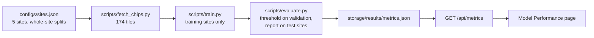

# Sylvan Watch

### Satellite forest-loss detection, validated on sites the models never saw

[](https://github.com/Shaik-Saniya67/sylvan-watch/actions/workflows/backend-ci.yml)
[](https://github.com/Shaik-Saniya67/sylvan-watch/actions/workflows/frontend-ci.yml)

**Neural Storm 2026 · Problem statement GP-04: Illegal Deforestation Detection** · Built by Shaik Saniya

Sylvan Watch compares cloud-masked Sentinel-2 imagery from two years, flags where forest canopy disappeared, measures the affected area as
georeferenced polygons, and reports how closely three different detectors agree with Hansen reference labels on **geographically held-out sites**,
with confidence intervals and every limitation stated.


*Change analysis view captured on a local development server on 3 Nov 2026, before the final evaluation. It illustrates the interface and output, not the final model's accuracy.*

| | |
|---|---|
| **Live app** | https://project-mzb0n.vercel.app/ |
| **Backend API and OpenAPI docs** | https://sylvan-watch-api.onrender.com · https://sylvan-watch-api.onrender.com/docs |
| **Source** | https://github.com/Shaik-Saniya67/sylvan-watch |

## At a glance

| | |
|---|---|
| **Real data** | 174 Sentinel-2 and Hansen tiles from 5 sites in Brazil, Indonesia and India, downloaded through Google Earth Engine |
| **Models compared** | Spectral-index baseline, Random Forest, Siamese U-Net, scored on the same held-out test sites |
| **Best held-out result** | Random Forest: F1 **0.545** (95% CI 0.487–0.598), recall **0.808**, precision 0.411, IoU 0.374 |
| **Validation design** | Whole sites assigned to train, validation or test; thresholds and model choice use validation data only; tile-bootstrap confidence intervals |
| **Output** | Loss polygons with area (ha), coordinates, model confidence and land-cover context; interactive map; downloadable report |
| **Stack** | Next.js 15 · FastAPI · scikit-learn · PyTorch · Google Earth Engine · Vercel · Render · GitHub Actions |

**Guide for judges**

| Criterion | Where to look |
|---|---|
| Technical implementation | [Technical approach](#5-technical-approach), [Results](#6-results), [Engineering quality](#7-engineering-quality) |
| Impact and usefulness | [Why this matters](#1-why-this-matters), [Product tour](#2-product-tour), [Reading a detection result](#3-reading-a-detection-result) |
| Documentation | This file: [problem](#1-why-this-matters), [approach](#5-technical-approach), [results](#6-results), [setup](#10-run-it-yourself), [screenshots](#2-product-tour) |
| Demo | Live links above, [product tour](#2-product-tour), [try it in two minutes](#try-it-in-two-minutes) |

## Project status

| Component | Status |
|---|---|
| Sentinel-2, Hansen and WorldCover download through Earth Engine | **Verified on real data**: 174 eligible tiles downloaded and confirmed readable |
| Spectral baseline and Random Forest training and evaluation | **Completed on real data** |
| Siamese U-Net | Trained and evaluated, but its training was **interrupted during epoch 3**; not a fair comparison (see [Results](#6-results)) |
| Evaluation results in the deployed app | **Verified**: the live Model Performance page and landing page show the real metrics; the health endpoint confirms the Random Forest model and metrics are loaded |
| Detection workflow (draw area, retrieve imagery, detect, polygons, area, report) | **Run on real Sentinel-2 imagery** (see the change-analysis capture). Accuracy of individual runs against independent field or high-resolution reference data has not been measured |
| Independent validation against hand-traced reference polygons | Implemented (`--reference`), **not yet run**; all scores measure agreement with Hansen labels |
| PostgreSQL/PostGIS | **Not implemented**; runs are stored as files under `storage/runs/` |

## 1. Why this matters

**The problem.** The 2025 annual analysis from the University of Maryland's GLAD lab, published through WRI's Global Forest Watch in
April 2026, found that the world lost 4.3 million hectares of tropical primary rainforest in 2025. That is 36% below the record year 2024 but still 46%
higher than a decade earlier, and fires accounted for 42% of global tree cover loss
([source](https://www.wri.org/news/release-tropical-rainforest-loss-drops-36-2025-fires-threaten-global-progress)). Forests are too large to patrol on the
ground, so the first question for any agency is: *where did canopy just disappear?*

**A note on wording.** The Global Forest Watch reports say "forest loss" rather than "deforestation" because satellite data cannot always show the cause.
Sylvan Watch follows the same discipline: it detects **forest-cover loss**, and it never claims to prove that a clearing was illegal.

**The gap this fills.** Turning raw imagery into a short, georeferenced list of candidate loss areas that a human can review needs cloud handling, label
handling, model selection and honest validation. Sylvan Watch packages that whole chain as a reproducible pipeline with a web interface.

**Intended users** (potential use cases, not claims of adoption):

- Forest departments and conservation teams triaging where to send limited patrol and field-verification effort.
- NGOs and journalists who need quick, reproducible area estimates for a region and period.
- Supply-chain and carbon-market due-diligence teams screening plots for recent canopy loss before a deeper review.

**What it deliberately does not do.** Imagery shows that canopy was removed, not whether the clearing was permitted. Judging legality needs boundary,
permit and field data. The app's reports say this in plain words.

## 2. Product tour

| | |
|---|---|
|  |  |
| **Landing.** Headline held-out metrics, drawn from the same report as the full evaluation, with the pipeline stages. | **Model performance.** Three models side by side with confidence interval, calibration error, confusion matrix and per-site scores. |
|  |  |
| **Landing hero.** The live deployment's front page with the headline, project tag and entry points to the workspace and validation. | **Imagery on the map.** A Sentinel-2 composite georeferenced onto the satellite basemap (early development capture, 2 Nov 2026). |
|  |  |
| **Datasets and split.** Whole-site split, Hansen loss rates, exact dataset versions and the limitations, on the page itself. | **Methodology.** Data sources, processing steps and scientific limitations in plain language. |

The change-analysis view at the top of this README shows loss pixels (coral) and polygon outlines (yellow) over the satellite basemap, with total hectares, patch count,
share of scanned forest and cloud-free coverage.

### Try it in two minutes

1. Open the [live app](https://project-mzb0n.vercel.app/) and go to **Model performance** to see the real evaluation, per-site scores and limitations.
2. Open **Methodology** for the data sources and processing steps.
3. In **Workspace**, draw an area (up to 15 km per side), choose a before and after year and a season, pick a model and run the detection.
   Imagery is fetched live from Earth Engine, so a run takes time. When it finishes you are taken to the **Change analysis** view.
4. Open **Reports** to download the analysis report for a finished run.
5. Browse the API at [`/docs`](https://sylvan-watch-api.onrender.com/docs). The free-tier backend may need a short wake-up on the first request.

## 3. Reading a detection result

Every finished run reports the following. None of it states or implies legality.

| Field | Meaning |
|---|---|
| Estimated forest-cover loss (ha) | Area of predicted loss pixels kept after the minimum-size filter (0.5 ha), computed from the projected 10 m pixel grid |
| Detected patches | Number of 8-connected loss polygons, each with centroid longitude and latitude |
| Scanned forest (ha) and share lost | Forest at the before date with clear observations in both periods, and the percentage of it flagged as loss |
| Cloud-free coverage | Share of the selected area with clear observations in both periods |
| Confidence | Mean model probability inside the patch; a model score, not the probability that an activity was illegal |
| Land cover (2021) | ESA WorldCover class, which reflects the state after clearing, so "Cropland" on a patch can mean converted forest |
| Evaluation block | Held-out metrics of the model that produced the run, as recorded when the run executed |

Two cautions when interpreting a result:

- **Few patches do not prove little loss.** The evaluation shows the Random Forest recovers only 34.2% of Hansen loss pixels at the `seshachalam_ap` test site, so a
  low count in a low-loss area should be read as possible under-detection, not as confirmation of intact forest.
- **Treat patches as candidates for review.** With precision around 0.41 against Hansen labels, a share of flagged patches will not be loss in the reference data
  (some of those will be harvest or fire that Hansen also counts, others genuine model errors).

## 4. How it works

```mermaid
flowchart LR
    U["User: draw area,<br/>choose before/after periods"] --> FE["Next.js frontend<br/>(Vercel)"]
    FE -->|REST| API["FastAPI backend<br/>(Render)"]
    API --> JOB["Background job runner<br/>(real stage + progress)"]
    JOB --> GEE["Google Earth Engine<br/>Sentinel-2 · Hansen · WorldCover"]
    GEE --> CHIP["10 m GeoTIFF tiles<br/>(cloud-masked composites)"]
    CHIP --> FEAT["27 features:<br/>bands, differences,<br/>NDVI / NBR / NDMI"]
    FEAT --> MODEL["Trained detector<br/>(baseline / RF / U-Net)"]
    MODEL --> POLY["Polygons + area (ha)<br/>+ confidence + land cover"]
    POLY --> STORE[("storage/runs/&lt;id&gt;/<br/>files")]
    STORE --> API
    API --> FE
```



**Detection workflow**

1. Select an area (up to 15 km per side) and the before and after years and season.
2. Retrieve Sentinel-2, Hansen and WorldCover layers through Earth Engine, tile by tile, on a shared 10 m UTM grid.
3. Build cloud-masked before and after composites.
4. Compute spectral indices and temporal features.
5. Identify forest-loss candidates with the selected trained model. Only pixels that were forest at the before date are scanned.
6. Convert predicted loss pixels into 8-connected, georeferenced polygons.
7. Estimate area on the projected pixel grid and provide the interactive result, the report and downloadable detections.

**Experiment workflow (completed on real data)**



## 5. Technical approach

### Data

| Dataset | Earth Engine asset | Role |
|---|---|---|
| Sentinel-2 Surface Reflectance Harmonized (L2A) | `COPERNICUS/S2_SR_HARMONIZED` | Model input: bands B2, B3, B4, B8, B11, B12 at 10 m |
| Hansen Global Forest Change | `UMD/hansen/global_forest_change_2025_v1_13` | Reference labels and forest definition |
| ESA WorldCover | `ESA/WorldCover/v200` | Land-cover context for each detection; never a label |

- **Cloud and shadow masking** with the Scene Classification Layer (cloud, shadow, cirrus, saturated and snow pixels removed), then a median composite of
  the scenes in a season. Each pixel keeps a count of clear observations, and pixels with none in either period are excluded.
- **Seasonal consistency.** Before and after composites use the same months in different years to limit phenology-driven false positives.
- **Hansen interpretation for the 2019 to 2023 experiment.** Forest at the before date means tree cover of at least 30% in 2000 and no loss up to 2019. A pixel
  is labelled loss if its Hansen loss year is in 2020 to 2023.

> **Hansen is a Landsat-derived reference product (30 m, annual), not field-verified ground truth.** Every metric here measures agreement with Hansen labels.
> Hansen also counts plantation harvest and fire as loss, and its annual timing only roughly matches seasonal composites.

### Features and models

27 features per pixel: six reflectance bands at each date, their differences, and NDVI, NBR and NDMI at both dates with their differences (before minus after,
so loss is positive).

| Model | Description |
|---|---|
| Spectral baseline | Flags a pixel when both dNBR and dNDVI exceed thresholds fitted by grid search on training tiles. The interpretable reference point |
| Random Forest | 300 trees on the 27 features, balanced class weights, probability output with a validation-chosen threshold |
| Siamese U-Net | Weight-shared encoder, decoder skip connections built from the absolute feature difference between dates, weighted BCE plus Dice loss over forest pixels only, early stopping on validation F1 |

### Experimental design

Whole **sites** are assigned to a split, so no test pixel has a training pixel as a spatial neighbour. Thresholds are chosen on validation sites only, the model is
selected by validation F1, and test sites are used for reporting.

| Split | Sites | Tiles | Hansen loss rate |
|---|---|---:|---:|
| Train | rondonia_a | 36 | 13.69% |
| Validation | riau_sumatra, hasdeo_arand | 66 | 12.39% |
| Test | rondonia_b, seshachalam_ap | 72 | 1.64% |
| **Total** | 5 sites | 174 | — |

| Design decision | Reason |
|---|---|
| Whole-site splits instead of random tiles | Neighbouring pixels are strongly correlated; random splits would leak information and inflate scores |
| Thresholds and model choice on validation only | Keeps the test set an unbiased, single-use measurement |
| Scoring only forest pixels with clear observations | Models are judged on pixels that could actually show forest loss |
| Bootstrap over whole tiles for the F1 interval | Pixels within a tile are correlated, so resampling tiles gives an honest interval |
| Loss-class precision, recall, F1 and IoU as headline metrics | With rare loss, overall accuracy hides failure (see [Results](#6-results)) |
| Calibration reported (Brier, ECE) | Polygon "confidence" is only meaningful if probabilities are reasonably calibrated |
| WorldCover as context, not as a label | Avoids circular reasoning and still helps triage harvest or cropland false alarms |

**Caveats that shape the results**

- The **training split contains a single geographic site**, so geographic generalisation is not demonstrated.
- The test set is **highly imbalanced**: Hansen loss is 1.64% of test forest pixels, against about 13% in training and validation.
- Most test loss comes from `rondonia_b` (57,907 of 60,163 reference loss pixels, about 96%). `seshachalam_ap` has only 2,256.
- Per-site results are therefore reported next to the pooled numbers.

## 6. Results

### Model comparison (held-out test sites)

| Model | Precision | Recall | F1 | 95% F1 CI | IoU | Validation F1 | ECE |
|---|---:|---:|---:|---:|---:|---:|---:|
| Spectral baseline | 0.274 | 0.683 | 0.392 | 0.335–0.447 | 0.243 | 0.501 | — |
| **Random Forest (selected)** | 0.411 | 0.808 | **0.545** | 0.487–0.598 | 0.374 | 0.682 | 0.073 |
| Siamese U-Net | 0.094 | 0.803 | 0.168 | 0.108–0.247 | 0.092 | 0.280 | 0.122 |

- **Random Forest was selected by the highest validation F1.** Test data were not used to choose the model or any decision threshold.
- It improves on the spectral baseline by about 0.15 F1, and the two confidence intervals do not overlap. Learned temporal features add real signal over a
  fixed dNBR and dNDVI rule.
- **The Siamese U-Net performed poorly and is not the winning model.** Its training was **interrupted during epoch 3**, so the score is not a fair
  comparison against the completed classical models. Its pattern (recall 0.803, precision 0.094) means it flags far more pixels than the reference contains,
  which is typical of an undertrained network under a loss that up-weights the rare class. This is an interpretation, not a tested diagnosis. The training script
  writes its history file only when a run finishes, which is why the Model Performance page shows no training curve for it. It was not optimised further, and no
  claim is made about what a fully trained U-Net could reach on this data.

### Random Forest in detail

| Metric | Value |
|---|---:|
| Decision threshold (chosen on validation) | 0.55 |
| Precision / Recall / F1 | 0.411 / 0.808 / 0.545 |
| 95% F1 interval (tile bootstrap) | 0.487–0.598 |
| IoU (loss) / Mean IoU | 0.374 / 0.676 |
| Accuracy | 0.978 |
| Brier score / Expected calibration error | 0.0234 / 0.0726 |

| Class | Precision | Recall | IoU |
|---|---:|---:|---:|
| Loss | 0.411 | 0.808 | 0.374 |
| Stable | 0.997 | 0.981 | 0.978 |

**Confusion matrix (test, pooled; rows are Hansen reference, columns are predictions)**

| Actual / Predicted | Stable | Loss |
|---|---:|---:|
| Stable | 3,545,902 | 69,580 |
| Loss | 11,578 | 48,585 |

**Per-site test results**

| Site | Precision | Recall | F1 | Reference loss pixels |
|---|---:|---:|---:|---:|
| rondonia_b | 0.410 | 0.826 | 0.548 | 57,907 |
| seshachalam_ap | 0.486 | 0.342 | 0.402 | 2,256 |

### How to read these numbers

- **Pooled accuracy is misleading here.** Loss is only 60,163 of 3,675,645 scored test pixels. Predicting "stable" everywhere would score about 98.4% accuracy
  (derived from the confusion matrix totals), higher than the model's 0.978, while finding no loss. Use loss-class precision, recall, F1 and IoU.
- **High recall, moderate precision.** The model finds about four in five Hansen loss pixels, but more than half of its loss predictions are not Hansen
  loss. Part of that is likely Hansen's limits (30 m labels against 10 m imagery, harvest and fire counted as loss, annual timing). Without independent reference
  polygons it cannot be separated from true model false alarms.
- **Prevalence shift probably lowers test precision.** Precision falls when the positive class is rarer, and test prevalence is roughly eight times lower than training.
  The gap between validation F1 (0.682) and test F1 (0.545) is partly explained by this, since the validation sites resemble the training prevalence.
- **`seshachalam_ap` is a hard case**: recall 0.342 on only 2,256 reference pixels. Its estimate is noisy, and it is a reminder not to extrapolate from `rondonia_b`.
- **Calibration is reasonable** for a probability model (ECE 0.0726), but polygon confidence is a mean model probability, not a guarantee of correctness.

## 7. Engineering quality

| Area | What is in the repository |
|---|---|
| Modular backend | Separate packages for API, data acquisition, geospatial processing, ML, and inference pipeline; type hints and docstrings on public functions |
| Reproducibility | Site definitions in `configs/sites.json`; seeded training (default 42); chips cached on disk; dataset asset IDs recorded in `metrics.json` and in every run |
| Honest evaluation | Site-level splits, validation-only selection, bootstrap intervals, calibration, optional independent-reference scoring |
| Robust API | Input validation (area size, year order, season), background jobs reporting real stage and progress, atomic status writes, clear errors when a model or Earth Engine is unavailable, OpenAPI docs |
| Tests | Unit tests for indices, labels, metrics, area and polygon geometry, plus an end-to-end pipeline test that stubs only the Earth Engine download; synthetic inputs are used for tests only, never for training or evaluation |
| CI/CD | GitHub Actions on every pull request and push to `main`; deployment through the Vercel and Render Git integrations |
| Frontend | Next.js 15 with TypeScript, a typed API client, explicit loading, error and empty states, and accessible controls |

### CI/CD

Continuous integration runs on **GitHub Actions** (`.github/workflows/`). Deployment stays with the existing Git integrations: Vercel deploys the frontend and Render
deploys the backend. The workflows contain no deployment steps and use no secrets.

| Workflow | File | Runs | Steps |
|---|---|---|---|
| Backend CI | `backend-ci.yml` | Python 3.12 (same minor version as `backend/Dockerfile`) | install from `backend/requirements-dev.txt`, `compileall` on `sylvan`, `scripts` and `tests`, then `pytest` |
| Frontend CI | `frontend-ci.yml` | Node 22 | `npm ci` from `package-lock.json`, `npm run typecheck`, `npm run build` |

- **Triggers:** every pull request and every push to `main`. A newer run on the same branch cancels the older one. Jobs have read-only repository permissions.
- **Release flow:** a push to `main` triggers CI and, independently, the Vercel and Render deployments. CI does not gate them. To make Render wait for green checks,
  enable its auto-deploy option "After CI Checks Pass".
- **No credentials needed:** tests use synthetic inputs and a stubbed Earth Engine download, so CI cannot assess detection quality on real imagery. Model accuracy
  comes from the real-data experiment in [section 6](#6-results).
- **PyTorch in CI:** the backend job installs the CPU build from the official PyTorch index to avoid downloading CUDA libraries. Requirement files are unchanged.
- **Siamese U-Net tests:** run in their own step marked `continue-on-error` because they had not been executed before CI was added. After one green run, remove that line
  to make them blocking.
- **Frontend static checks:** the project defines no ESLint script, so `npm run typecheck` (`tsc --noEmit`) is the static check, followed by the production build.

## 8. Limitations and responsible interpretation

- Hansen labels are reference data, not field truth. Reported accuracy is agreement with that product.
- Imagery cannot determine whether forest clearing is illegal. Sylvan Watch reports forest-cover loss only.
- Plantation harvesting and fire may be labelled as forest loss, by Hansen and by the models.
- Selective logging and removal of individual trees fall below the resolution of 10 m optical imagery and may not be detected.
- Metrics apply only to the selected sites, seasons and years (2019 to 2023).
- Geographic generalisation is limited: one training site, five sites in total.
- Class imbalance in the test set affects interpretation; see [section 6](#6-results).
- The Siamese U-Net run was interrupted and must not be treated as a completed model comparison.
- The example detection runs have not been checked against independent reference data, so their area estimates carry the same uncertainty as the evaluation.
- One detection runs at a time, and areas are limited to 15 km per side.

## 9. Roadmap

| Next step | Why |
|---|---|
| Add training sites across more regions and re-evaluate | Test whether results generalise beyond a single training site |
| Complete the Siamese U-Net training (up to 40 epochs, early stopping, seeded) and re-run the comparison | Replace an interrupted run with a fair comparison |
| Trace 20 to 30 independent loss and stable polygons on high-resolution imagery in the test sites and run `evaluate.py --reference` | Separate model error from Hansen label noise |
| Overlay protected-area and reserved-forest boundaries | Prioritise candidates inside them for human review without claiming legality |
| Persist runs in PostGIS and add a job queue | Concurrent users and durable history |

## 10. Run it yourself

**Requirements:** Python 3.11+, Node 20+, a Google Earth Engine account registered for a Cloud project.

```bash
# Backend
cd backend
python -m venv .venv && source .venv/bin/activate
pip install -r requirements-dev.txt
cp .env.example .env            # edit values; never commit .env
earthengine authenticate        # or configure a service account in .env
pytest                          # synthetic-input unit and pipeline tests
uvicorn sylvan.api.main:app --reload --port 8000     # API docs at http://localhost:8000/docs

# Frontend
cd ../frontend
cp .env.example .env.local      # set NEXT_PUBLIC_API_URL
npm install
npm run dev                     # http://localhost:3000
```

**Earth Engine.** Set `SYLVAN_EE_PROJECT`. For servers, create a service account with Earth Engine access and set `SYLVAN_EE_SERVICE_ACCOUNT` and
`SYLVAN_EE_PRIVATE_KEY_FILE`. If authentication fails the API returns the exact error and setup help; it never substitutes other data.

**Dataset version.** The reported experiment used Hansen `UMD/hansen/global_forest_change_2025_v1_13`. Set it explicitly to reproduce:

```bash
export SYLVAN_HANSEN_ASSET=UMD/hansen/global_forest_change_2025_v1_13
```

**Reproduce the experiment**

```bash
cd backend
python scripts/fetch_chips.py            # downloads real chips; prints a per-site loss-rate audit (resumable)
python scripts/train.py                  # spectral baseline + Random Forest + Siamese U-Net (seed 42)
python scripts/evaluate.py               # writes storage/results/metrics.json
python scripts/evaluate.py --reference my_polygons.geojson   # optional independent validation
```

- Sites, years and seasons are defined in `backend/configs/sites.json`; whole sites are assigned to train, validation or test.
- Chips, weights and results are written under `storage/` and are git-ignored. Weights and `metrics.json` must be available to the backend that serves
  `/api/metrics` and detections.
- Training is seeded (default 42). GPU runs can still differ slightly because some CUDA kernels are non-deterministic.
- `--epochs` sets the Siamese U-Net length; training stops early after 8 epochs without validation improvement and keeps the best validation checkpoint.
- Reference file for `--reference`: GeoJSON in WGS84, each feature with `properties.kind` set to `"loss"` or `"stable"`. Only pixels inside these polygons are scored.

**Deployment.** Frontend on Vercel with `NEXT_PUBLIC_API_URL` pointing to the backend. Backend on Render using `backend/Dockerfile`, with Earth Engine credentials as
secrets and `SYLVAN_CORS_ORIGINS` set to the frontend origin.

## 11. API

Interactive OpenAPI documentation: https://sylvan-watch-api.onrender.com/docs (it lists the exact report formats and schemas).

| Method | Path | Purpose |
|---|---|---|
| GET | `/api/health` | Liveness, available trained models, whether an evaluation exists |
| GET | `/api/metrics` | Evaluation report; returns 404 with an explanation if none exists |
| POST | `/api/detections` | Queue a detection run (area up to 15 km per side, years from 2018, season within one calendar year) |
| GET | `/api/detections` | List runs |
| GET | `/api/detections/{id}` | Run status with real stage and progress; result and GeoJSON when finished |
| GET | `/api/detections/{id}/images/{before\|after\|change}.png` | Before, after and loss-overlay previews |
| GET | `/api/detections/{id}/report` | Downloadable report and detections for a finished run |

## 12. Repository structure

```text
.github/workflows/  backend-ci.yml, frontend-ci.yml (GitHub Actions CI)
backend/
  sylvan/
    api/          FastAPI app, request schemas, background jobs and run registry
    data/         Earth Engine client and chip GeoTIFF I/O
    geo/          AOI validation, 10 m UTM tiling, pixel area, polygon extraction
    ml/           indices, features, Hansen labels, detectors, training, evaluation, reference validation
    pipeline/     end-to-end inference, rendering, reports
  scripts/        fetch_chips.py, train.py, evaluate.py
  configs/        sites.json (site definitions and splits)
  tests/          unit and pipeline tests (synthetic inputs)
frontend/
  app/            pages: landing, workspace, analysis, performance, reports, about
  components/     map, progress, confusion matrix, motion components
  lib/            typed API client
docs/
  screenshots/    images used in this README
```

## 13. Credits and AI tools used

**Data.** Contains modified Copernicus Sentinel data (ESA). Hansen, M. C. et al. (2013), High-Resolution Global Maps of 21st-Century Forest Cover Change, *Science* 342,
850–853 (University of Maryland / GLAD). ESA WorldCover 10 m 2021 v200. Forest-loss context statistics: WRI and University of Maryland GLAD lab, Global Forest Watch
annual analysis, April 2026. The map basemap uses Esri World Imagery tiles; check Esri's terms before any production use.

**Motion.** Landing-page and chart animations adapt four techniques from the MIT-licensed [NullMotion](https://github.com/blixvip/NullMotion) project (blur reveal, kinetic
headline, line draw, node network), re-implemented with Framer Motion. No NullMotion code was copied.

**AI tools used.** Claude (Anthropic) was used to generate and iterate on the code and documentation. The author ran the data download, training, evaluation and
deployment, and is responsible for the reported results.
